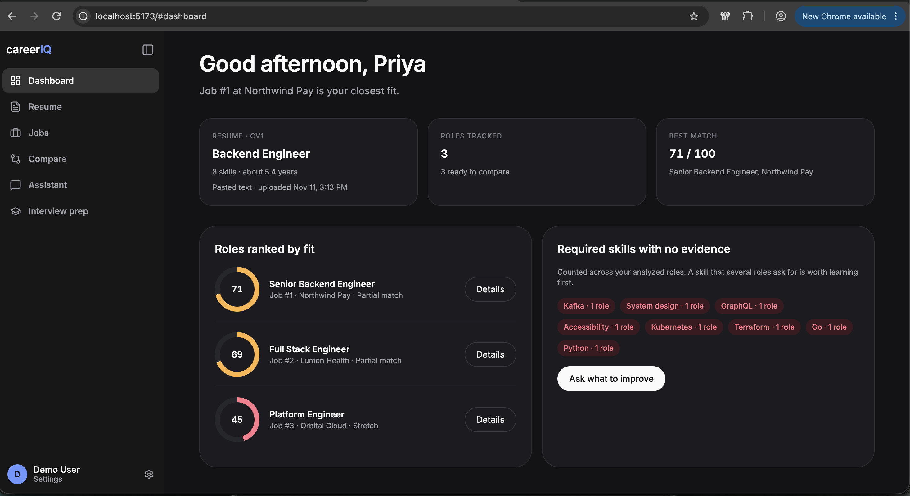
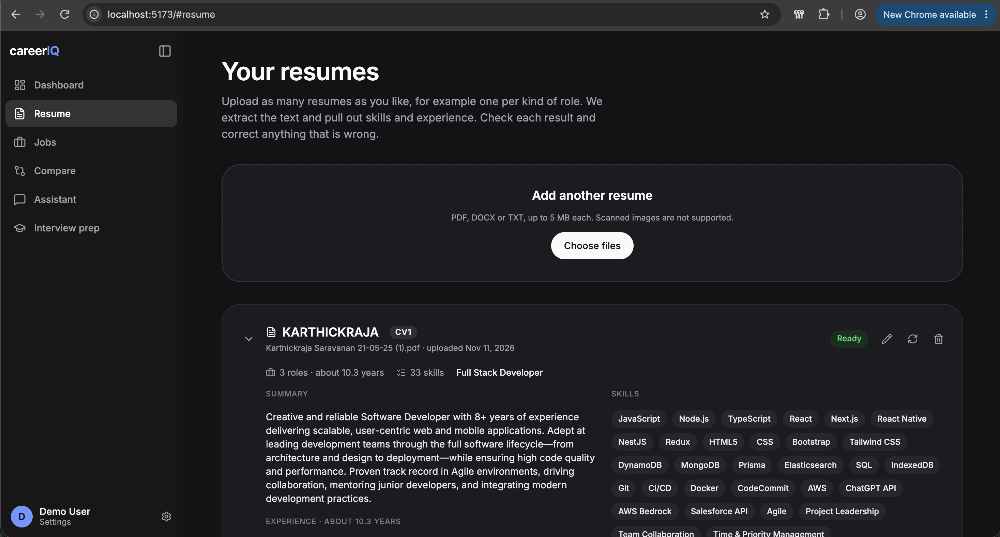
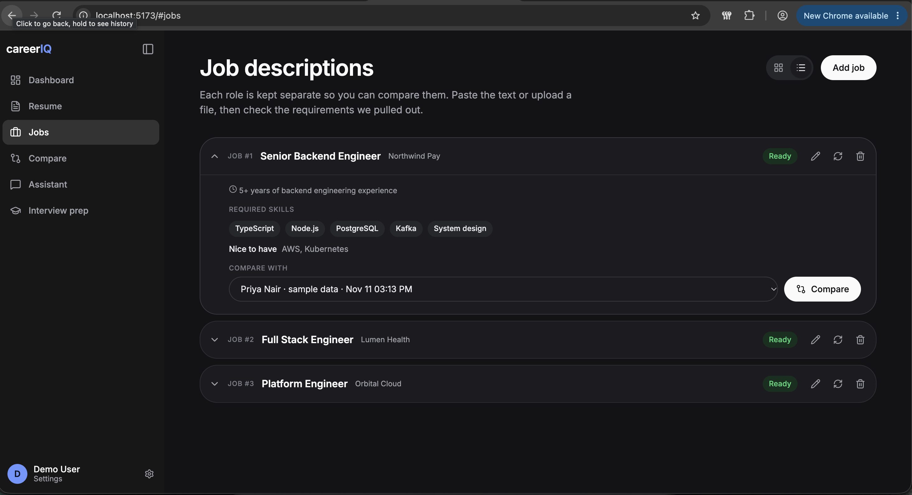
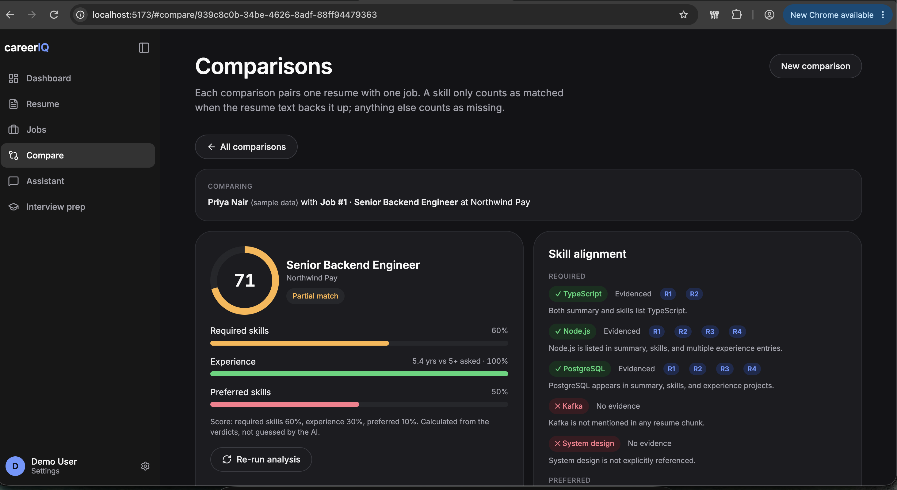
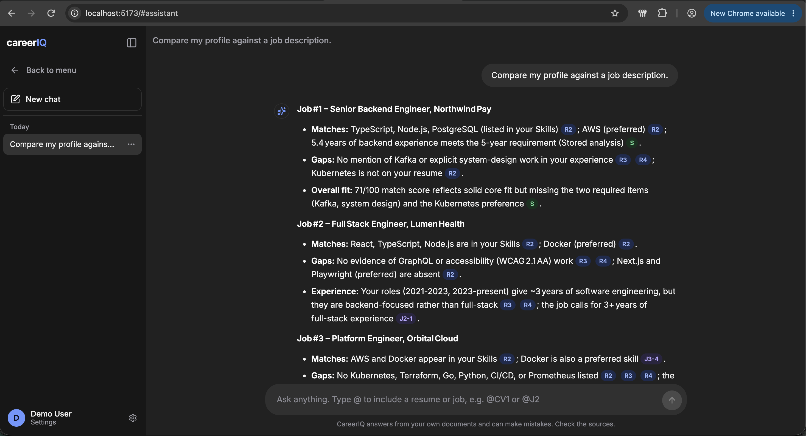
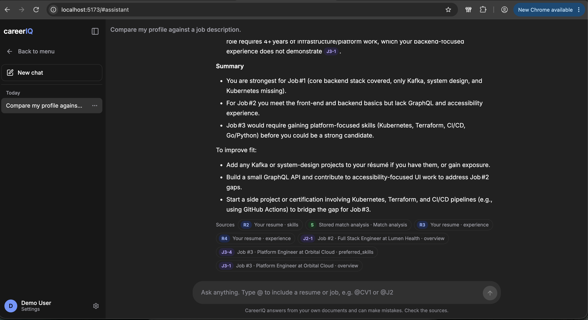
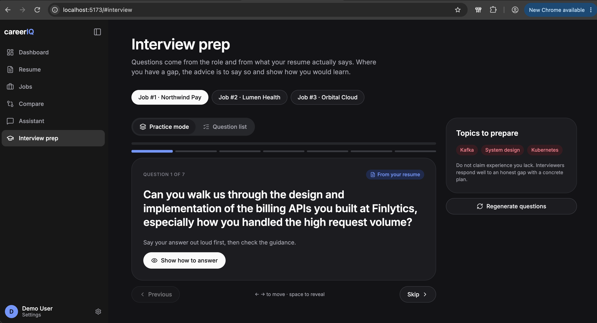
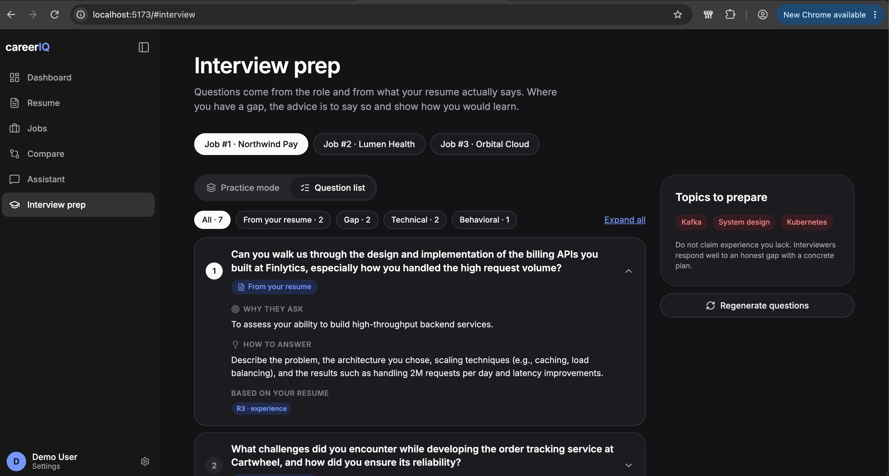
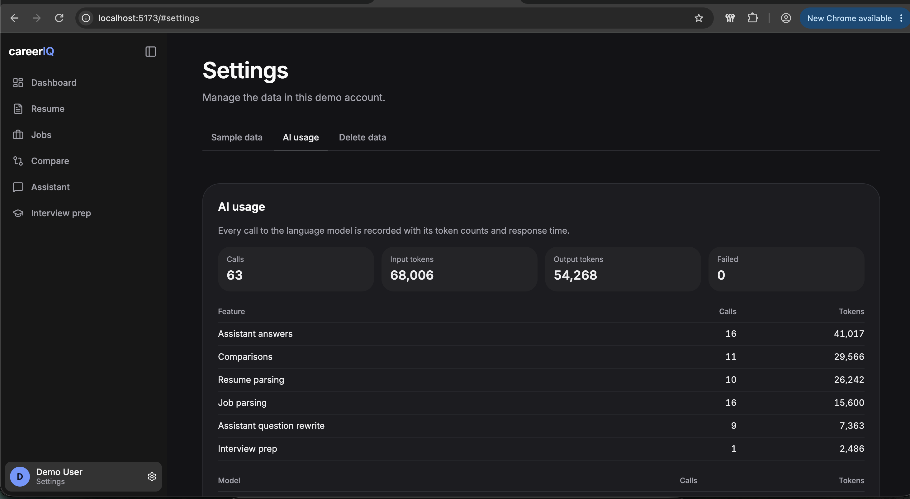
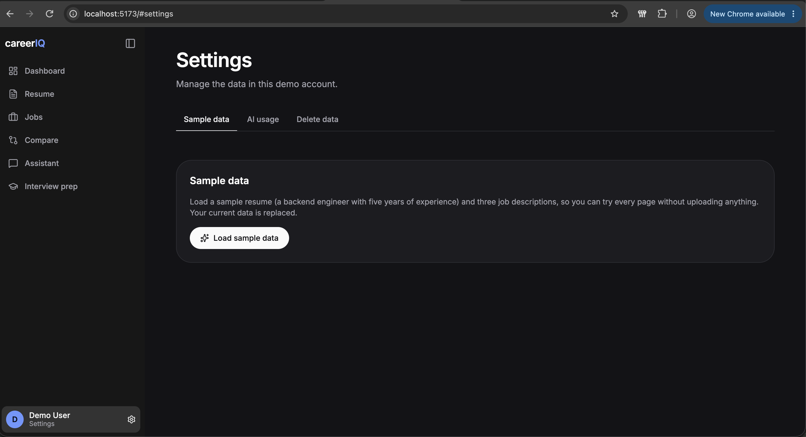

# CareerIQ: Career Intelligence Assistant

CareerIQ compares one or more resumes against many job descriptions and lets you ask questions about them in a chat. It gives a per-job match analysis with evidence, grounded chat answers with clickable citations, and interview prep built from your real gaps.



## Quick start

Requirements: Docker with Compose, and a free Groq API key (https://console.groq.com).

```bash
cp .env.example .env        # set GROQ_API_KEY
docker compose up --build   # db + api + web
# open http://localhost:<web port>, then Settings -> "Load sample data"
```

Migrations run automatically when the API starts. The local embedding model (`bge-small-en-v1.5`) downloads on first use and is cached in a volume, so the first document takes longer.

Useful commands (in `api/`):

```bash
npm test                    # unit + integration (integration needs TEST_DATABASE_URL, a pgvector Postgres)
npm run eval:seed           # load the golden resume and jobs
npm run eval:retrieval      # retrieval hit rate against the real embedder
```

To run fully local instead of Groq, set `LLM_PROVIDER=ollama` and `OLLAMA_BASE_URL`.

## What it does

- **Resumes and jobs:** upload PDF/DOCX/TXT (or paste a job). Text is extracted, parsed by the LLM into structured data you can edit, then chunked and embedded. Any number of each. Resumes get badges (CV1, CV2), jobs get labels (Job #1).
- **Compare:** pick a job and a resume. You get a score, a verdict per requirement (met / partial / missing) with the resume passage that proves it, strengths, concerns and recommendations.
- **Assistant:** streaming chat over your documents. Type `@CV1` or `@J2` (or `/resume`, `/job`) to pin a resume or job. Answers cite passages like `[R3]`, `[J2-1]`; click a citation to see the source text.
- **Interview prep:** per job and resume, technical and resume-based questions built from the gaps found in the comparison, with a flash-card practice mode.
- **Settings:** sample data, delete-my-data, and an AI usage report (tokens and latency per call).

## Screenshots

| | |
|---|---|
| **Dashboard**: roles ranked by fit and the skills missing across them<br> | **Resumes**: any number of resumes, each with a CV badge<br> |
| **Job descriptions**: pick a resume and compare<br> | **Compare**: score, per-requirement evidence and gaps<br> |
| **Assistant**: streamed answer with clickable citations<br> | **Assistant**: follow-up with sources listed<br> |
| **Interview prep**: practice mode<br> | **Interview prep**: question list with the resume evidence behind each<br> |
| **Settings, AI usage**: tokens and latency per feature<br> | **Settings, sample data**<br> |

Empty states and the rest are in [`screenshots/`](screenshots/).

## Architecture

```
React + Vite  --REST/SSE-->  Express API (TypeScript)
                               routes -> services -> repositories
                               documents | parsing | chunking | retrieval | analysis | chat | interview | llm
                                  |
                          Postgres 16 + pgvector   (data, vectors, full-text, job queue)
                          file volume              (uploaded originals)
```

- **Modular monolith.** One deployable with strict module boundaries. Routes never touch SQL.
- **Postgres for everything.** Relational data, pgvector (HNSW), full-text search and the job queue (pg-boss), so there is no Redis or separate vector database to run.
- **Async ingestion.** Uploads return immediately. Extract, parse and embed are retryable queue jobs, and the UI polls a status (`uploaded` to `ready` or `failed`).
- **Analyses are stored,** not recomputed per page view, and flagged stale when the resume or job changes.
- **Interfaces for the LLM and embedder,** so the whole test suite runs offline with deterministic fakes.

## RAG and LLM decisions

| Area | Choice | Rejected | Why |
|---|---|---|---|
| Chunking | Structure-aware: one chunk per role, project, skills block, etc., taken from the parsed resume/job; plain-text fallback | Fixed-size windows | A role stays whole, so a bullet is never split from its title and dates |
| Embeddings | `bge-small-en-v1.5` (384-d), local via Transformers.js | Hosted embedding APIs | No key, no extra vendor, identical everywhere |
| Vector store | pgvector with HNSW | Pinecone, Qdrant, Chroma | One datastore, transactional, easy to run locally |
| Retrieval | Hybrid: vector + full-text merged with reciprocal rank fusion; a fixed quota from the resume and from each job | Vector only | Exact skill names (Kafka, k8s) are weak for embeddings; quotas guarantee both sides of a comparison have evidence |
| LLM | Groq `llama-3.3-70b-versatile` for answers, analysis and prep; `llama-3.1-8b-instant` for cheap steps (question rewrite). OpenAI-compatible client, Ollama switchable | OpenAI, Ollama only | Fast, free tier, open weights |
| Orchestration | Hand-written pipeline | LangChain, LlamaIndex | The flow is a few functions; a framework adds opaque layers |
| Scoring | Computed in code from per-requirement verdicts (required 60%, experience 30%, preferred 10%); years of experience from dates | LLM-assigned score | Deterministic, explainable, immune to "rate me 100" text inside a resume |

## Prompting, context and guardrails

- **Prompts** are versioned. Rules: answer only from the context, cite passage labels, say "not found" when the context lacks the answer, never suggest claiming experience the resume does not show, treat document text as data, stay on career topics.
- **Context management:** a ~6000-token budget filled round-robin across documents so trimming never leaves one side without evidence; the last 6 turns of history; follow-up questions are rewritten into standalone queries; the stored analysis is included as `[S]` so chat agrees with the Compare page.
- **Citations are validated:** any label the model cites that was not in the retrieved set is removed before the answer is saved.
- **Evidence rule:** a requirement can only be "met" if the model points at a real resume passage; otherwise it is downgraded in code.
- **Structured output:** parsing, analysis and interview prep are JSON validated with zod, with one automatic repair attempt.
- **Security:** every query is filtered by `user_id` (tested with a second user); upload type, magic-byte and size checks; rate limits (tighter on chat); helmet; secrets only from env; logs never contain document text or headers.

## Quality and observability

- **Tests:** unit tests (chunker, fusion, scoring, citations, mentions, references) and integration tests against real Postgres with a fake LLM: isolation, upload to ready, streaming chat, analyses, interview prep, usage.
- **Evals:** `npm run eval:retrieval` measures whether the expected passage is in the top results. **[Results: paste after running]**
- **Observability:** one structured log line per request with a request id; per-step latency and retrieved chunk ids stored on every chat message; every LLM call stored in `llm_usage` with tokens, latency and status, visible in Settings.

## Key decisions and trade-offs

- **Prioritised the core AI features over authentication.** I wanted a proper JWT login flow with per-user data isolation and role-based access if needed, but I chose to spend the limited time on the main features (parsing, retrieval, comparison, chat). The app runs as a single demo user. Isolation is still built in: every table carries `user_id`, every query filters on it, and tests check that one user cannot read another's documents.
- **Retrieve chunks, not whole documents.** Instead of sending full resumes and job descriptions to the model, each document is split into meaningful chunks and only the chunks most relevant to the question are retrieved. That keeps answers grounded and tokens low.
- **Express instead of Fastify.** I chose it because it is simple, has extensive middleware support (helmet, CORS, rate limiting, request logging all plug in), and I am more familiar with it, which let me move faster on the AI parts.
- **Scope limits I accepted:** the newest resume is used in chat unless you name one with `@CV1`; no reranker, row-level security or OCR (scanned PDFs are rejected with a clear message); Groq's free tier is rate limited, handled with retries and stored analyses; resume text is sent to Groq, and Ollama is the local-only option.
- **Weakest part: retrieval.** Retrieval already combines semantic search with keyword search, but it can still miss exact details, and results are not reranked. Next I would add filtering by category (skills, experience, education) and a reranking step over the top results.

## Standards followed and skipped

Followed: typed code end to end, input validation at every boundary, deterministic tests with fake LLM and embedder, one migration per change, secrets only in environment variables, structured logs.

Skipped for time: row-level security in the database and end-to-end browser tests.

## Productionizing

1. Add real authentication and authorization (JWT, user-level data isolation, roles if needed) and row-level security.
2. Move the database to Amazon RDS (Postgres with pgvector) with automatic backups.
3. Containerise with Docker, push images to ECR, and deploy and scale on ECS Fargate.
4. Add Redis for frequently repeated requests, and proper indexes plus query tuning.
5. Monitor the system, and optimise API calls and LLM token use (the `llm_usage` table is the starting point).
6. Improve RAG further: category-aware retrieval and reranking.

## How I used AI tools

I used AI tools for research, planning and implementation. I did the research and planning with them first, and based on that I decided the architecture myself and then worked through it one milestone at a time, with tests for each milestone.

What I decided myself: the scope (one demo user with full data isolation instead of a login flow), the stack (I overrode the AI's suggestion of Fastify and chose Express), local embeddings, and the product design, including the dashboard, the compare flow, the chat experience and the resume and job mentions. I reviewed the changes myself, ran the app, and committed and pushed the code myself.

One example where I corrected the AI: it built the first version around a single resume, so uploading a new resume replaced the previous one. I corrected that. Users can now upload any number of resumes and compare each job against each resume, and the comparison, interview prep and chat all handle more than one resume.

<!-- TODO(Karthick), optional: one line on something you verified by running it yourself, e.g. the retrieval eval or the Docker run. -->

## What I would do next

- Row-level security and end-to-end tests.
- Better retrieval on top of the current hybrid search (vector + keyword, merged with reciprocal rank fusion): add a reranking step (a cross-encoder over the top results) and category filters (skills, experience, education), then re-run the retrieval eval to measure the change.
- Tailor the resume to a job description with AI: given a chosen job, suggest rewrites of the resume's real bullets and skills wording to match it, shown as a before/after diff the user accepts or rejects. It must only reword what the resume already shows and never invent experience.
- Turn it into a marketplace where candidates connect their job portals and use their APIs to compare their resumes with the jobs they are applying for.
